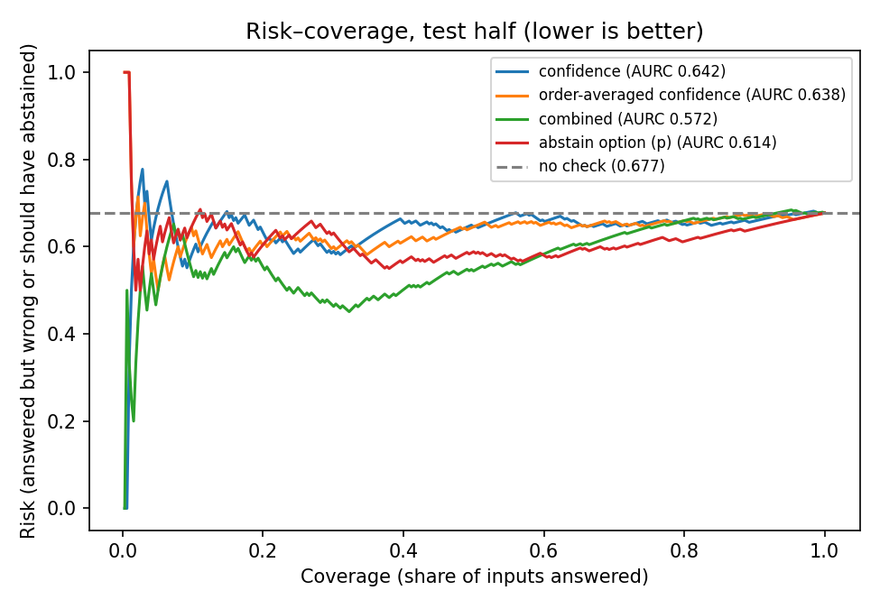

# Imaced

**A checker that tests whether an AI's answer is supported by the medical scan, and flags answers that need
human review.**

Live demo: **https://imaced.vercel.app** · Offline: open [`app/dist/index.html`](app/dist/index.html) (one
self-contained file) · Full checker write-up: [`CHECKER.md`](CHECKER.md)

---

## Why

We asked a vision-language model which side of a mammogram contained a breast mass. It correctly said
**left** (p = 0.94). Then we covered the mass with a gray box and asked again. It said **right**, with
**71%** confidence, and it still answered "right" when we offered "Cannot be determined from the image" as an
option ([ViTAR-16K #12834](demo_examples/vitar_12834/meta.json)).

The model answers whether or not the evidence is there, and with about the same confidence. Imaced is a check
that sits after the model and decides, per question, whether to **pass the answer along** or **defer it to a
human**, and says why.

## What it does

Given a question, an image and the model's answer, the checker outputs:

- **accept** (pass the answer along) or **defer** (send to human review), and
- for each deferral, the **signal that contributed most**, e.g. *"answer changes when options are reordered"*
  or *"model leans toward 'cannot be determined'"*.

None of its signals needs the correct answer or the location of the finding, so it can run at deployment time.

## How it works

```
ViTAR-16K question + scan
        │
        ▼
Qwen2.5-VL-7B-Instruct  ── one forward pass per prompt; read the option-letter probabilities
        │
        ├─ 4 cyclic reorderings of the options      → confidence, order-averaged confidence, consistency
        ├─ the same question with no image          → blind gain
        └─ an added "Cannot be determined" option   → p(abstain)
        │
        ▼
standardize → logistic regression (fit on the calibration half) → deferral score
        │
        ▼
score > 0.732 ? defer (+ main reason) : accept
```

### Model and data

- **Model:** [`Qwen/Qwen2.5-VL-7B-Instruct`](https://huggingface.co/Qwen/Qwen2.5-VL-7B-Instruct), bfloat16, on a
  Colab L4 GPU.
- **Data:** [`jline/ViTAR-16K`](https://huggingface.co/datasets/jline/ViTAR-16K), medical multiple-choice VQA with
  annotated evidence boxes. Classification questions only (tumor type, fundus category, tooth type, ...);
  yes/no, bounding-box, counting and position questions are excluded, because masking the evidence changes
  their right answer instead of making them unanswerable.
- **Prompt** (chat template, image first):

  ```
  Answer the multiple-choice question with only the letter of the correct option. Do not explain.

  Q: <question with options>
  A:
  ```

  We don't sample. We read the next-token log-probabilities of the option letters and renormalize them over
  the valid letters, which gives a probability for every option.

### Test inputs: labels for free

Each question is scored against several versions of its image. Whether the model *should* answer follows from
how the input was built, so no extra labeling is needed.

| Input | How it's made | Model should |
|---|---|---|
| `full` | original image | answer |
| `rand` | gray out a random box the same size as the evidence box, not overlapping it | answer (control) |
| `evid` | gray out the annotated evidence box | defer |
| `evid_big` | gray out the evidence box scaled 2.5× | defer |
| `mismatch_cross` | swap in a scan from a different body area | defer |
| `mismatch_same` | coordinate questions only: swap in a scan from the same body area | defer |

Gray is RGB (124, 116, 104). The evidence box is the smallest annotated box, preferring one that contains the
point the question names.

### The five signals

| Signal | What it measures | Learned weight* |
|---|---|---|
| `consistency` | share of 4 option orderings whose top answer matches the averaged answer (**shuffle test**) | −0.72 |
| `p_abstain` | probability of an added "Cannot be determined from the image" option | +0.60 |
| `C_orig` | top-option probability in the original order | +0.28 |
| `blind_gain` | log p(answer \| image) − log p(answer \| no image) (**blind test**) | +0.17 |
| `C_perm` | top-option probability averaged over the 4 orderings | −0.05 |

\*Standardized logistic-regression coefficients; positive pushes toward deferring. Read `C_orig` and `C_perm`
together, since they overlap heavily.

### Fitting and evaluation

- **Sample:** the first 300 classification questions after a seeded shuffle; **119** kept (answered correctly
  on the full image, evidence box ≤ 50% of the image, room for a control box).
- **Split by image** (MD5 of the pixels): 59 questions for calibration, **60 held out for test**. No image
  appears in both halves.
- **Threshold:** 0.732, the highest score that keeps deferrals on calibration full images at ≤ 10%.
- **Uncertainty:** 95% intervals from 2,000 bootstrap resamples by image.

## Results

Held-out test half, 60 questions. Full table with confidence intervals in [`CHECKER.md`](CHECKER.md) and
[`results/checker_v2/`](results/checker_v2/).

| | No check | Confidence only | **Imaced (combined)** |
|---|---|---|---|
| Should-defer inputs caught (deferred) | 0% | 20% | **30%** |
| Defers on scans swapped across body areas | 0% | 13% | **50%** |
| Accuracy of accepted answerable inputs | 85% | 90% | **90%** |
| Risk–coverage area (AURC, lower is better) | 0.677 | 0.642 | **0.572** |

On the three image types the demo focuses on (full, irrelevant region masked, evidence masked), wrong answers
that reach the user fall from **28 to 12** of 180, and the checker defers **7 of the 10** evidence-masked
inputs that Qwen got wrong.



### What we learned

- **A correct answer can come from the question, not the scan.** Across 998 screened questions, Qwen matched
  the benchmark label **44.7%** of the time with the image and **41.6%** without it
  ([`results/vitar_screen.csv`](results/vitar_screen.csv)).
- **The shuffle test is the strongest learned signal.** On the test half, 60 of 86 deferrals were mainly
  triggered by the answer changing when the options were reordered.
- **An "I don't know" option alone isn't enough.** Offered "Cannot be determined from the image", Qwen picks it
  on 65% of intact scans as well, so the checker uses its probability as one signal among five instead.

### Design choices

- **Signals from the answer itself.** Our first checker (v1) asked the model to point to its evidence and
  masked that region. Its boxes covered a median 60% of the scan, so v2 reads its signals directly from the
  answer probabilities: the shuffle test, the blind test and the "cannot be determined" option.
- **Controls for every mask.** Each evidence mask is paired with a same-size mask elsewhere in the image, and
  scans swapped across body areas give clean should-defer inputs, so a deferral reflects missing evidence
  rather than occlusion alone.

## Demo examples

[`demo_examples/`](demo_examples/) holds 8 cases with the exact images the model saw (full, evidence masked,
random masked) and per-option log-probs for every condition. They were picked by a fixed rule (masking the
evidence lowers p(correct) by ≥ 0.20, more than a random mask does, and the model is still right with the random
mask). The checker's decision on each image is in
[`results/checker_v2/demo_signals_decisions.csv`](results/checker_v2/demo_signals_decisions.csv): it defers on
the evidence-masked image for 4 of the 8 (#11695, #10282, #13407, #7414).

## Earlier study: evidence masking on 1000 questions

Before the checker, we screened 1000 shuffled classification questions
([`vitar_abstention.py`](vitar_abstention.py)) and kept 36 where Qwen was correct, confident (p ≥ 0.5) and
image-dependent (the image at least doubles p(correct) over the question alone). Dropping spine yes/no
questions in disguise left 15 core cases. On those, accuracy was 100% on the full image, 87% with a random
region masked, and 47% with the evidence masked; 8 of 15 switched to a wrong answer
([`results/vitar_core_summary.json`](results/vitar_core_summary.json)).

## Repository map

| File | What it does | Writes |
|---|---|---|
| `vitar_setup.py`, `vitar_baseline.py` | load ViTAR-16K and Qwen; full-image baseline on 20 examples | — |
| `vitar_abstention.py` | shared helpers (prompting, letter scoring, masks); 1000-question screen | `results/vitar_*.csv`, `vitar_summary.json` |
| `vitar_analyze.py` | summary of the screen, with and without spine yes/no questions | `results/vitar_core_summary.json` |
| `vitar_checker.py`, `vitar_calibrate.py` | v1 checker: confidence + grounding via pointing | `results/checker/` |
| `vitar_abstention_counts.py` | abstention counts for the v1 thresholds | `results/checker/abstention_counts_*.csv` |
| `vitar_checker_v2.py` | v2 signals for every question × input (Colab GPU) | `results/checker_v2/checker_v2_rows.csv` |
| `vitar_calibrate_v2.py` | fit the combiner on calibration, evaluate on test | `results/checker_v2/` report, tables, plot |
| `vitar_score_demo.py`, `vitar_apply_checker.py` | score the 8 demo examples and apply the fitted checker | `results/checker_v2/demo_signals*.csv` |
| `CHECKER.md` | full description of checker v2 and its results | — |
| `demo_examples/`, `demo_assets/` | demo cases: images and per-condition scores | — |
| `app/` | the Imaced web app (React) | `app/dist/index.html` |
| `site/` | an earlier single-file static page (15 core cases) | — |

## Reproduce

The model runs on a Colab GPU via the `google-colab-cli` command-line tool; scripts start a background thread
and you poll its state.

```bash
uv tool install google-colab-cli          # once, then sign in: colab sessions
colab new -s vlm --gpu L4
colab upload -s vlm results/checker/checker_rows.csv /content/checker_rows.csv
(echo RUN_SCREEN=False; cat vitar_abstention.py vitar_checker_v2.py) | colab exec -s vlm
echo 'print(V2STATE)' | colab exec -s vlm   # poll; the run takes about 25 minutes
colab download -s vlm /content/results/checker_v2/checker_v2_rows.csv results/checker_v2/checker_v2_rows.csv
colab stop -s vlm
```

Calibration and evaluation run anywhere (pandas, numpy, scikit-learn, matplotlib):

```bash
python vitar_calibrate_v2.py results/checker_v2/checker_v2_rows.csv results/checker_v2
python vitar_apply_checker.py results/checker_v2/demo_signals.csv
```

## The web app

[`app/`](app/) is the demo UI: React 19 + Vite, Tailwind CSS v4, shadcn/ui, and three.js
(@react-three/fiber). Screens: an overview with a 3D view of case #12834, a case walkthrough (the three images,
the verdict and a five-step check trace), results with a before/after chart, a gallery, and an architecture
page. Data and images are inlined, so `app/dist/index.html` opens straight from disk.

```bash
cd app
npm install
python scripts/build_data.py   # collect results/ and demo_examples/ into src/data/imaced.json
npm run dev                    # http://localhost:5180
npm run build                  # writes the single-file dist/index.html
```

## Next steps

- Test on more realistic inputs, especially scans from the same body area and questions the model gets wrong
  even on the intact scan.
- Review which masked cases remain answerable, to measure exactly when deferring is the right call.
- Extend to more vision-language models and prompts.

## Acknowledgements

Questions, images and evidence boxes from [ViTAR-16K](https://huggingface.co/datasets/jline/ViTAR-16K).
Model: [Qwen2.5-VL-7B-Instruct](https://huggingface.co/Qwen/Qwen2.5-VL-7B-Instruct).
